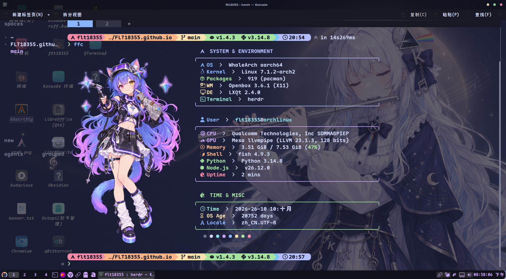

<div align="center">

# 🚀 FLT18355's Dotfiles


**一套精心配置、高度定制化的 Linux 开发环境**<br>
*Built with ❤️ & ☕ on Arch Linux ARM*

<br>

<!-- 状态徽章 -->
[](https://github.com/FLT18355/dotfiles)
[](https://github.com/FLT18355/dotfiles)
[](LICENSE)

<br>

<!-- 技术栈徽章 (统一 Catppuccin Mocha 风格) -->


</div>

---



## ✨ 核心特性

- 🎨 **统一美学**：从终端到窗口管理器，全面应用 Catppuccin 配色。
- ⚡ **极速启动**：基于 Openbox + 高度精简的配置，低配/移动设备也能起飞。
- 🐚 **Fish Shell**：提供智能补全、语法高亮与极致的交互体验。
- 🛠️ **自建工具链**：无缝集成自己编写的 CLI 工具（如 `gitx`），打通 GitHub 工作流。

## 📦 安装

```bash
git clone git@github.com:FLT18355/dotfiles.git
cd dotfiles
./install.sh -n   # 先看会创建哪些软链接
./install.sh      # 执行；已存在的目标默认跳过
./install.sh -f   # 需要覆盖时先备份为 *.bak.<时间戳>
```

映射规则：`config/*` → `~/.config/*`，`.local/*/*` → `~/.local/*/*`。
脚本（`scripts/`）不会自动安装，按需自行复制或加到 PATH。

当前项目适合直接让AI部署, 可以让AI读doc/

## 🧹 清理包管理器缓存

```bash
./scripts/cache/clean.sh          # 逐个询问
./scripts/cache/clean.sh -y       # 全清，不询问
./scripts/cache/clean.sh -n       # 只打印命令
./scripts/cache/clean.sh pip bun  # 只清指定项
```

## 🔄 更新自建 CLI

```bash
python3 scripts/updater/jj.py
python3 scripts/updater/herdr.py
python3 scripts/updater/omp.py
```

下载后会校验 Release 的 sha256，失败即中止，不会覆盖现有二进制。